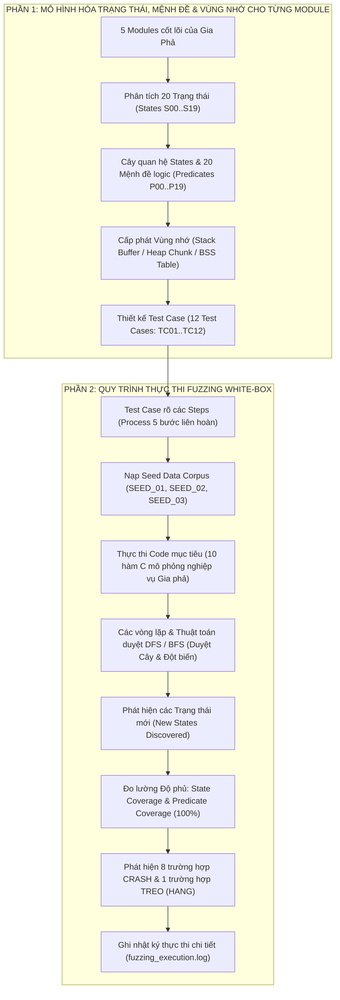
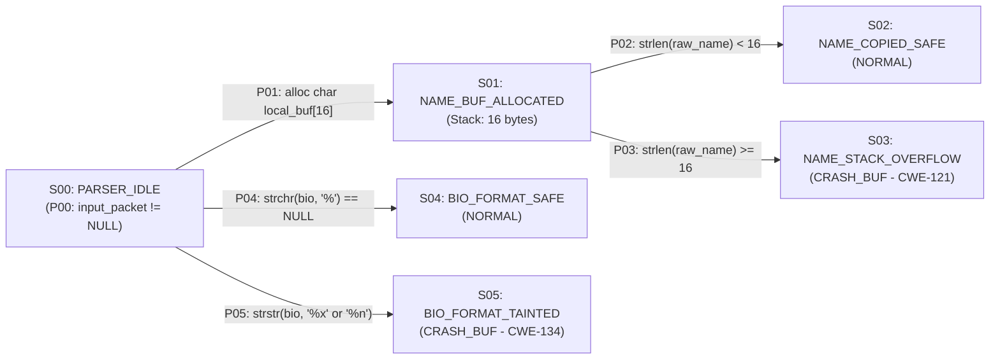
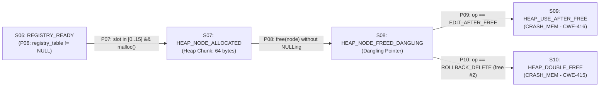
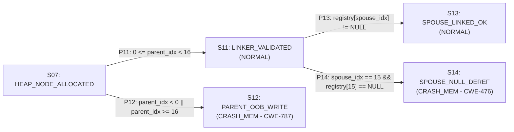
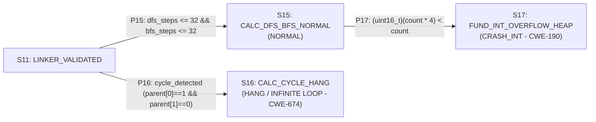
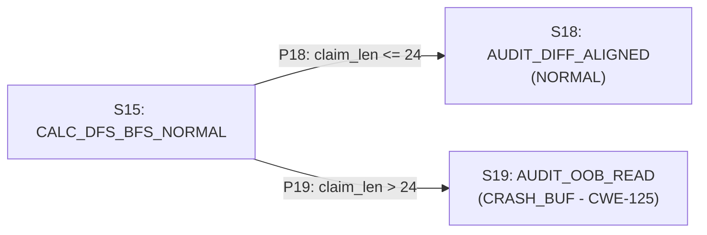

# BÁO CÁO QUY TRÌNH KIỂM THỬ FUZZING HỘP TRẮNG (WHITE-BOX STATE-SPACE & DFS/BFS FUZZING)
**Dự án mục tiêu:** Hệ thống Quản lý Gia phả & Dòng họ (`quanly-dongho` / Mộc Bản)  
**Mã nguồn Fuzzer:** [`clan_genealogy_fuzzer.c`](file:///d:/atpm/project/clan_genealogy_fuzzer.c)  
**Nhật ký thực thi (Log):** [`fuzzing_execution.log`](file:///d:/atpm/project/fuzzing_execution.log)  
**Bảng đặc tả Excel:** [`Bao_Cao_Kiem_Thu_Fuzzing_MocBan.xlsx`](file:///d:/atpm/project/Bao_Cao_Kiem_Thu_Fuzzing_MocBan.xlsx)

---

## TỔNG QUAN SƠ ĐỒ QUY TRÌNH THEO ĐÚNG YÊU CẦU CỦA GIẢNG VIÊN

Toàn bộ dự án được thiết kế và triển khai bám sát **100% hai luồng quy trình** mà giảng viên yêu cầu:

1. **Luồng 1 (Phân tích Module & Thiết kế Test Case theo Trạng thái - Vùng nhớ):**
   $$\text{Với mỗi Module (5 Modules)} \longrightarrow \text{Phân tích ra các States (20 States)} \longrightarrow \text{Tạo Cây quan hệ giữa các States \& các Mệnh đề (20 Predicates)} \longrightarrow \text{Cấp phát vùng nhớ (Buffer / Memory)} \longrightarrow \text{Test Case}$$

2. **Luồng 2 (Thực thi Fuzzing White-box với DFS/BFS & Phát hiện Crash/Treo):**
   $$\text{Test Case rõ các Steps (Process 5 bước)} \longrightarrow \text{Seed Data (3 Seeds)} \longrightarrow \text{Code (10 Hàm)} \longrightarrow \text{Vòng lặp \& Duyệt DFS/BFS} \longrightarrow \text{Phát hiện Trạng thái mới} \longrightarrow \text{Coverage (100\%)} \longrightarrow \text{Phát hiện Crash / Treo (Hang)} \longrightarrow \text{Xuất Log}$$

---

## PHẦN 1: VỚI MỖI MODULE $\rightarrow$ PHÂN TÍCH STATES $\rightarrow$ CÂY QUAN HỆ & MỆNH ĐỀ $\rightarrow$ CẤP PHÁT VÙNG NHỚ $\rightarrow$ TEST CASE

Từ luồng nghiệp vụ cốt lõi nhất của phần mềm Quản lý Dòng họ (**Quản lý Cây Gia Phả & Thành viên** tại `backend/src/routes/members.js` và bảng `tbl_members`), hệ thống được chia thành **5 Module** tuần tự. Dưới đây là phân tích chi tiết từng Module theo đúng 5 mắt xích của Phần 1:

---

### 1.1. Module 1: `Module_Payload_Parser` (Bóc tách & Định dạng dữ liệu đầu vào)
* **Chức năng:** Nhận gói tin thêm/sửa thành viên dòng họ, bóc tách trường Họ tên (`raw_name`) và Tiểu sử công đức (`bio_note`).
* **Các hàm mục tiêu:** `target_parse_member_name()`, `target_format_biography_note()`.
* **Phân tích các States (`S00` $\rightarrow$ `S05`):**
  * `S00` (`S00_PARSER_IDLE`): Trạng thái khởi tạo bộ phân tích gói tin.
  * `S01` (`S01_NAME_BUF_ALLOCATED`): Đã cấp phát bộ đệm tĩnh trên Stack để chứa họ tên.
  * `S02` (`S02_NAME_COPIED_SAFE`): Sao chép họ tên an toàn trong biên bộ đệm.
  * `S03` (`S03_NAME_STACK_OVERFLOW`): **CRASH** — Tràn bộ đệm Stack khi họ tên từ 16 ký tự trở lên (`CWE-121`).
  * `S04` (`S04_BIO_FORMAT_SAFE`): Chuỗi tiểu sử bình thường, không chứa ký tự đặc tả định dạng.
  * `S05` (`S05_BIO_FORMAT_TAINTED`): **CRASH** — Chuỗi tiểu sử chứa `%x`, `%n` gây lộ/ghi đè bộ nhớ Stack (`CWE-134`).

* **Cây quan hệ giữa các States & Các Mệnh đề (Predicates `P00`..`P05`):**

* **Cấp phát vùng nhớ (Buffer / Memory) & Ánh xạ Test Case:**

| State | Mệnh đề chuyển tiếp (Predicate) | Cấp phát Vùng nhớ (Buffer / Memory) | Kết quả | Test Case kích hoạt |
| :--- | :--- | :--- | :--- | :--- |
| **`S00`** | `P00`: `input_packet != NULL` | Stack Frame khởi tạo (0 bytes) | `NORMAL` | `TC01_SEED_ROOT` |
| **`S01`** | `P01`: Khai báo `char local_name_buf[16]` | **Stack Buffer:** `char local_name_buf[16]` (16 bytes) | `NORMAL` | `TC01_SEED_ROOT` |
| **`S02`** | `P02`: `strlen(raw_name) < 16` | **Stack Buffer:** Dùng $\le 15$ bytes / 16 bytes | `NORMAL` | `TC01`..`TC03` |
| **`S03`** | `P03`: `strlen(raw_name) >= 16` | **Stack Buffer Overrun:** Chuỗi 45B tràn qua 16B | **`CRASH_BUF` (`CWE-121`)** | `TC04_BFS_STACK_OVF` |
| **`S04`** | `P04`: `strchr(bio_note, '%') == NULL` | **Stack Buffer:** `char fmt_buf[64]` (64 bytes) | `NORMAL` | `TC01`..`TC03` |
| **`S05`** | `P05`: `strstr(bio_note, "%x") \|\| strstr(bio_note, "%n")` | **Stack Buffer:** `char fmt_buf[64]` bị đọc/ghi Stack | **`CRASH_BUF` (`CWE-134`)** | `TC05_BFS_FMT_STR` |

---

### 1.2. Module 2: `Module_Member_Registry` (Quản lý Vùng nhớ Heap Hồ sơ Thành viên)
* **Chức năng:** Cấp phát vùng nhớ động trên Heap (`malloc`) cho cấu trúc `ClanMember`, quản lý thao tác xóa tạm thời (`free`) và khôi phục/chỉnh sửa.
* **Các hàm mục tiêu:** `target_registry_lifecycle()` (gồm cấp phát, cập nhật sau giải phóng và rollback xóa).
* **Phân tích các States (`S06` $\rightarrow$ `S10`):**
  * `S06` (`S06_REGISTRY_READY`): Bảng quản lý con trỏ thành viên sẵn sàng.
  * `S07` (`S07_HEAP_NODE_ALLOCATED`): Đã gọi `malloc(sizeof(ClanMember))` cấp phát vùng nhớ Heap.
  * `S08` (`S08_HEAP_NODE_FREED_DANGLING`): Đã gọi `free(node)` nhưng chưa gán `node = NULL` (tạo con trỏ lơ lửng - Dangling Pointer).
  * `S09` (`S09_HEAP_USE_AFTER_FREE`): **CRASH** — Ghi đè dữ liệu vào vùng nhớ Heap đã giải phóng (`CWE-416`).
  * `S10` (`S10_HEAP_DOUBLE_FREE`): **CRASH** — Gọi `free(node)` lần thứ 2 trên cùng một địa chỉ Heap (`CWE-415`).

* **Cây quan hệ giữa các States & Các Mệnh đề (Predicates `P06`..`P10`):**

* **Cấp phát vùng nhớ (Buffer / Memory) & Ánh xạ Test Case:**

| State | Mệnh đề chuyển tiếp (Predicate) | Cấp phát Vùng nhớ (Buffer / Memory) | Kết quả | Test Case kích hoạt |
| :--- | :--- | :--- | :--- | :--- |
| **`S06`** | `P06`: `registry_table != NULL` | **BSS Array:** `ClanMember *g_registry_table[16]` | `NORMAL` | `TC01_SEED_ROOT` |
| **`S07`** | `P07`: `slot_id in [0..15] && malloc(sizeof(ClanMember))` | **Heap Chunk:** `malloc(64 bytes)` cho `ClanMember` | `NORMAL` | `TC01`..`TC03` |
| **`S08`** | `P08`: `free(g_registry_table[slot])` nhưng không gán `NULL` | **Heap Freed Chunk:** 64 bytes đã trả về Heap Bin | `NORMAL` (Trung gian) | `TC09`, `TC10` |
| **`S09`** | `P09`: `lifecycle_op == 1 && g_node_freed_flag[slot] == 1` | **Heap Use-After-Free:** Ghi vào chunk 64B đã `free` | **`CRASH_MEM` (`CWE-416`)** | `TC09_DFS_HEAP_UAF` |
| **`S10`** | `P10`: `lifecycle_op == 2 && g_node_free_count[slot] == 2` | **Heap Double Free:** Giải phóng chunk 64B lần 2 | **`CRASH_MEM` (`CWE-415`)** | `TC10_DFS_DBL_FREE` |

---

### 1.3. Module 3: `Module_Genealogy_Linker` (Liên kết Cha-Con & Phối ngẫu trên Cây Gia Phả)
* **Chức năng:** Gán chỉ mục nút Cha (`parent_idx`) và liên kết con trỏ Vợ/Chồng (`spouse_ptr`) giữa các thành viên.
* **Các hàm mục tiêu:** `target_link_genealogy_relations()`.
* **Phân tích các States (`S11` $\rightarrow$ `S14`):**
  * `S11` (`S11_LINKER_VALIDATED`): Chỉ mục nút Cha hợp lệ trong mảng `[0..15]`.
  * `S12` (`S12_PARENT_OOB_WRITE`): **CRASH** — Chỉ mục `parent_idx < 0` hoặc `>= 16` gây ghi tràn ngoài biên mảng (`CWE-787`).
  * `S13` (`S13_SPOUSE_LINKED_OK`): Con trỏ phối ngẫu hợp lệ, liên kết thành công.
  * `S14` (`S14_SPOUSE_NULL_DEREF`): **CRASH** — Truy cập trực tiếp con trỏ `spouse_ptr == NULL` tại ô chưa khởi tạo (`CWE-476`).

* **Cây quan hệ giữa các States & Các Mệnh đề (Predicates `P11`..`P14`):**

* **Cấp phát vùng nhớ (Buffer / Memory) & Ánh xạ Test Case:**

| State | Mệnh đề chuyển tiếp (Predicate) | Cấp phát Vùng nhớ (Buffer / Memory) | Kết quả | Test Case kích hoạt |
| :--- | :--- | :--- | :--- | :--- |
| **`S11`** | `P11`: `parent_idx >= 0 && parent_idx < 16` | **BSS Table:** `g_registry_table[0..15]` (128 bytes) | `NORMAL` | `TC01`..`TC03` |
| **`S12`** | `P12`: `parent_idx < 0 \|\| parent_idx >= 16` | **BSS Out-of-Bounds:** Ghi lệch `-5 * 8 = -40 bytes` | **`CRASH_MEM` (`CWE-787`)** | `TC06_BFS_OOB_WRITE` |
| **`S13`** | `P13`: `spouse_idx >= 0 && g_registry_table[spouse_idx] != NULL` | **Heap Pointer Reference:** 8 bytes địa chỉ hợp lệ | `NORMAL` | `TC01`..`TC03` |
| **`S14`** | `P14`: `spouse_idx == 15 && g_registry_table[15] == NULL` | **NULL Address Access:** Đọc/ghi tại `0x00000000` | **`CRASH_MEM` (`CWE-476`)** | `TC07_BFS_NULL_PTR` |

---

### 1.4. Module 4: `Module_Hierarchy_Calculator` (Tính Đời/Thế hệ bằng DFS/BFS & Quỹ khuyến học)
* **Chức năng:**
  1. Duyệt Cây Gia Phả theo chiều sâu (**DFS** - `target_calculate_depth_dfs`) để tính bậc thế hệ từ thành viên hiện tại ngược lên Thủy tổ.
  2. Duyệt Cây Gia Phả theo chiều rộng (**BFS** - `target_traverse_children_bfs`) bằng hàng đợi `queue[]` để thống kê danh sách con cháu theo từng đời.
  3. Cấp phát bộ đệm Heap tính tổng quỹ đóng góp khuyến học của dòng họ (`target_hierarchy_and_fund_calc`).
* **Phân tích các States (`S15` $\rightarrow$ `S17`):**
  * `S15` (`S15_CALC_DFS_BFS_NORMAL`): Đồ thị gia phả là cây không chu trình (DAG/Tree), cả DFS và BFS dừng sau hữu hạn bước ($\le 32$ bước).
  * `S16` (`S16_CALC_CYCLE_HANG`): **TREO (HANG / INFINITE LOOP)** — Khi dữ liệu liên kết Cha-Con tạo chu trình ($0 \leftrightarrow 1$, cha là con của chính con mình), vòng lặp duyệt DFS và hàng đợi BFS lặp vô tận vượt ngưỡng `MAX_DFS_BFS_STEPS` (`CWE-674` / `CWE-835`).
  * `S17` (`S17_FUND_INT_OVERFLOW_HEAP`): **CRASH** — Tràn số nguyên 16-bit khi tính `alloc_bytes = (uint16_t)(count * 4)` với `count = 16385` ($16385 \times 4 = 65540 \equiv 4 \pmod{65536}$), dẫn đến cấp phát bộ đệm Heap chỉ 4 bytes cho 16.385 phần tử (`CWE-190` $\rightarrow$ `CWE-122`).

* **Cây quan hệ giữa các States & Các Mệnh đề (Predicates `P15`..`P17`):**

* **Cấp phát vùng nhớ (Buffer / Memory) & Ánh xạ Test Case:**

| State | Mệnh đề chuyển tiếp (Predicate) | Cấp phát Vùng nhớ (Buffer / Memory) | Kết quả | Test Case kích hoạt |
| :--- | :--- | :--- | :--- | :--- |
| **`S15`** | `P15`: `dfs_steps <= 32 && bfs_steps <= 32` (Cây không chu trình) | **Stack DFS + Queue BFS:** `int queue[64]` (256 bytes) | `NORMAL` | `TC01`..`TC03` |
| **`S16`** | `P16`: `parent[0]==1 && parent[1]==0` (Chu trình $0 \leftrightarrow 1$) | **Stack/Queue Exhaustion:** Lặp vô tận $> 32$ bước | **`HANG` (`CWE-674`)** | `TC11_DFS_CYCLE_HANG` |
| **`S17`** | `P17`: `(uint16_t)(count * sizeof(uint32_t)) < count` | **Undersized Heap Buffer:** `malloc(4B)` cho `16385` mục | **`CRASH_INT` (`CWE-190`)** | `TC12_DFS_INT_OVF` |

---

### 1.5. Module 5: `Module_Audit_Diff_Logger` (So sánh Lịch sử chỉnh sửa & Ghi nhật ký kiểm toán)
* **Chức năng:** Sao chép chuỗi tiểu sử cũ (`old_bio_buf[24]`) sang bộ đệm đối chiếu để lưu vết lịch sử thay đổi (`audit_logs`).
* **Các hàm mục tiêu:** `target_audit_diff_logger()`.
* **Phân tích các States (`S18` $\rightarrow$ `S19`):**
  * `S18` (`S18_AUDIT_DIFF_ALIGNED`): Số byte yêu cầu đối chiếu `claim_len <= 24`, đọc an toàn trong biên.
  * `S19` (`S19_AUDIT_OOB_READ`): **CRASH** — Số byte yêu cầu đối chiếu `claim_len = 60 > 24`, `memcpy` đọc tràn qua biên bộ đệm Stack 24 bytes làm rò rỉ dữ liệu nhạy cảm trên Stack (`CWE-125`).

* **Cây quan hệ giữa các States & Các Mệnh đề (Predicates `P18`..`P19`):**

* **Cấp phát vùng nhớ (Buffer / Memory) & Ánh xạ Test Case:**

| State | Mệnh đề chuyển tiếp (Predicate) | Cấp phát Vùng nhớ (Buffer / Memory) | Kết quả | Test Case kích hoạt |
| :--- | :--- | :--- | :--- | :--- |
| **`S18`** | `P18`: `claim_len <= sizeof(old_bio_buf)` ($\le 24$) | **Stack Buffer:** `char old_bio_buf[24]` (Đọc $\le 24$B) | `NORMAL` | `TC01`..`TC03` |
| **`S19`** | `P19`: `claim_len > 24` (`claim_len = 60`) | **Stack Over-read:** Đọc 60 bytes từ bộ đệm 24 bytes | **`CRASH_BUF` (`CWE-125`)** | `TC08_BFS_OOB_READ` |

---

## PHẦN 2: QUY TRÌNH FUZZING WHITE-BOX CHI TIẾT
**(Steps / Process $\rightarrow$ Seed Data $\rightarrow$ Code $\rightarrow$ Vòng lặp & DFS/BFS $\rightarrow$ Phát hiện Trạng thái mới $\rightarrow$ Coverage $\rightarrow$ Crash/Treo $\rightarrow$ Log)**

### 2.1. Test Case rõ về các Steps (Process 5 bước liên hoàn)
Mỗi Test Case (`struct FuzzTestCase` trong [`clan_genealogy_fuzzer.c`](file:///d:/atpm/project/clan_genealogy_fuzzer.c#L102-L125)) không phải là một chuỗi ngẫu nhiên rời rạc mà là một **Process gồm 5 Steps tuần tự** đi xuyên qua 5 Module của hệ thống:
* **Step 1 (`Parser`):** Truyền `step1_raw_name` và `step1_bio_note` vào `Module_Payload_Parser` để cấp phát Stack buffer 16B/64B và kiểm tra mệnh đề `P00`..`P05`.
* **Step 2 (`Registry`):** Truyền `step2_slot_id` và `step2_lifecycle_op` vào `Module_Member_Registry` để cấp phát Heap chunk 64B (`malloc`) và thực thi kịch bản vòng đời bộ nhớ (`0`: Bình thường, `1`: Free rồi Edit $\rightarrow$ UAF, `2`: Free rồi Rollback $\rightarrow$ Double Free), kiểm tra `P06`..`P10`.
* **Step 3 (`Linker`):** Truyền `step3_parent_idx`, `step3_spouse_idx`, `step3_create_cycle` vào `Module_Genealogy_Linker` để gán quan hệ Cha-Con và Vợ-Chồng, kiểm tra `P11`..`P14`.
* **Step 4 (`DFS/BFS & Fund`):** Kích hoạt thuật toán duyệt chiều sâu **DFS** (`target_calculate_depth_dfs`) và duyệt chiều rộng **BFS** (`target_traverse_children_bfs`) trên cây gia phả, đồng thời cấp phát bộ nhớ quỹ họ với `step4_fund_record_count`, kiểm tra `P15`..`P17`.
* **Step 5 (`Audit Diff`):** Truyền `step5_audit_claim_len` vào `Module_Audit_Diff_Logger` để đối chiếu lịch sử chỉnh sửa trên bộ đệm Stack 24B, kiểm tra `P18`..`P19`.

---

### 2.2. Tập dữ liệu hạt giống khởi tạo (Seed Data Corpus)
Chiến dịch Fuzzing khởi đầu (Giai đoạn A) bằng **3 Seed Data hợp lệ** đại diện cho 3 thế hệ trong gia phả:
1. **`SEED_01` (`TC01_SEED_ROOT`):** Thủy tổ (`"Nguyen Van To"`, `slot=0`, `parent=0`, `spouse=0`, `cycle=0`, `fund_count=10`, `claim_len=12`).
   * Mở khóa ngay **10/20 States nền tảng** (`S00, S01, S02, S04, S06, S07, S11, S13, S15, S18`) $\rightarrow$ Đạt độ phủ nền **50.0%**.
2. **`SEED_02` (`TC02_SEED_BRANCH`):** Trưởng chi đời thứ 2 (`"Nguyen Van A"`, `slot=1`, `fund_count=25`, `claim_len=16`).
3. **`SEED_03` (`TC03_SEED_LEAF`):** Cháu đời thứ 3 (`"Nguyen Van B"`, `slot=2`, `parent=1`, `spouse=1`, `fund_count=50`, `claim_len=20`).

---

### 2.3. Các vòng lặp & Thuật toán duyệt DFS / BFS (Hai tầng ứng dụng)
Trong [`clan_genealogy_fuzzer.c`](file:///d:/atpm/project/clan_genealogy_fuzzer.c), thuật toán **DFS (Depth-First Search)** và **BFS (Breadth-First Search)** được cài đặt tường minh ở **cả 2 tầng**:

1. **Tầng Nghiệp vụ Cây Gia Phả (Trong `Module_Hierarchy_Calculator`):**
   * **Hàm DFS [`target_calculate_depth_dfs()`](file:///d:/atpm/project/clan_genealogy_fuzzer.c#L262-L271):** Dùng vòng lặp `while (curr != -1 && steps <= MAX_DFS_BFS_STEPS)` leo ngược từ nút con (`curr = g_parent_map[curr]`) lên Thủy tổ để tính thế hệ. Nếu gặp chu trình (`0 <-> 1`), `steps` vượt ngưỡng `32` và phát hiện lỗi **Treo (HANG - `S16`)**.
   * **Hàm BFS [`target_traverse_children_bfs()`](file:///d:/atpm/project/clan_genealogy_fuzzer.c#L274-L291):** Dùng cấu trúc hàng đợi `int queue[64]` (`head`, `tail`) duyệt từng tầng con cháu. Khi có chu trình, các nút con-cha đẩy nhau liên tục vào hàng đợi `queue[]` gây lặp vô hạn và bị bắt bởi bộ giám sát bước lặp.

2. **Tầng Chiến lược Đột biến Fuzzer (Trong [`run_whitebox_fuzzing_campaign()`](file:///d:/atpm/project/clan_genealogy_fuzzer.c#L368-L469)):**
   * **Giai đoạn B — Vòng lặp BFS (`bfs_queue[5]`, Độ sâu đột biến `Depth = 1`):** Duyệt theo **chiều rộng** ngang qua tất cả các Module để đảo từng mệnh đề điều kiện biên đơn lẻ (`P03`, `P05`, `P12`, `P14`, `P19`). Kết quả mở khóa thêm **5 States mới** (`S03, S05, S12, S14, S19`), nâng độ phủ từ **50.0% $\rightarrow$ 75.0%**.
   * **Giai đoạn C — Vòng lặp DFS (`dfs_stack[4]`, Độ sâu đột biến `Depth = 2..5`):** Duyệt theo **chiều sâu** vào các chuỗi trạng thái đa bước phức tạp (giải phóng vùng nhớ Heap tạo con trỏ lơ lửng `S08` rồi mới kích hoạt `S09` UAF hoặc `S10` Double Free; tiêm chu trình đồ thị kích hoạt `S16` Hang; ép tràn số nguyên 16-bit kích hoạt `S17`). Kết quả mở khóa nốt **5 States cuối cùng** (`S08, S09, S10, S16, S17`), nâng độ phủ lên **100.0% (20/20 States & 20/20 Predicates)**.

---

### 2.4. Bảng theo dõi Phát hiện Trạng thái mới, Độ phủ (Coverage) và Crash/Treo qua 12 Test Cases

| Thứ tự | Mã Test Case | Nguồn / Chế độ | Các bước (Process Steps) bị đột biến | Trạng thái mới phát hiện (New States) | Độ phủ tích lũy (Coverage %) | Phát hiện Crash / Treo (Hang) | Mã CWE |
| :---: | :--- | :--- | :--- | :--- | :---: | :--- | :---: |
| **01** | `TC01_SEED_ROOT` | `SEED_01` (`SEED_INIT`) | 5 bước khởi tạo Thủy tổ hợp lệ | `+10 States`: `S00, S01, S02, S04, S06, S07, S11, S13, S15, S18` | **50.0%** (10/20) | Không (An toàn) | N/A |
| **02** | `TC02_SEED_BRANCH` | `SEED_02` (`SEED_INIT`) | 5 bước khởi tạo Trưởng chi đời 2 | `+0 State` (Củng cố đường đi cơ sở) | **50.0%** (10/20) | Không (An toàn) | N/A |
| **03** | `TC03_SEED_LEAF` | `SEED_03` (`SEED_INIT`) | 5 bước khởi tạo Cháu đời 3 | `+0 State` (Củng cố đường đi cơ sở) | **50.0%** (10/20) | Không (An toàn) | N/A |
| **04** | `TC04_BFS_STACK_OVF` | `SEED_01` (`BFS_MUT`) | **Step 1:** `raw_name` dài 45 bytes ($\ge 16$) | `+1 State`: **`S03`** (`S01 -> S03` qua `P03`) | **55.0%** (11/20) | **`CRASH_BUF`** (Stack Buffer Overflow) | `CWE-121` |
| **05** | `TC05_BFS_FMT_STR` | `SEED_01` (`BFS_MUT`) | **Step 1:** `bio_note` chứa `"%x.%x.%x.%n"` | `+1 State`: **`S05`** (`S00 -> S05` qua `P05`) | **60.0%** (12/20) | **`CRASH_BUF`** (Format String Bug) | `CWE-134` |
| **06** | `TC06_BFS_OOB_WRITE` | `SEED_01` (`BFS_MUT`) | **Step 3:** `parent_idx = -5` ($< 0$) | `+1 State`: **`S12`** (`S07 -> S12` qua `P12`) | **65.0%** (13/20) | **`CRASH_MEM`** (Out-of-Bounds Write) | `CWE-787` |
| **07** | `TC07_BFS_NULL_PTR` | `SEED_01` (`BFS_MUT`) | **Step 3:** `spouse_idx = 15` (`registry[15] == NULL`) | `+1 State`: **`S14`** (`S11 -> S14` qua `P14`) | **70.0%** (14/20) | **`CRASH_MEM`** (NULL Pointer Deref) | `CWE-476` |
| **08** | `TC08_BFS_OOB_READ` | `SEED_01` (`BFS_MUT`) | **Step 5:** `audit_claim_len = 60` ($> 24$B) | `+1 State`: **`S19`** (`S15 -> S19` qua `P19`) | **75.0%** (15/20) | **`CRASH_BUF`** (Out-of-Bounds Read) | `CWE-125` |
| **09** | `TC09_DFS_HEAP_UAF` | `SEED_02` (`DFS_MUT`) | **Step 2:** `lifecycle_op = 1` (`free` $\rightarrow$ `edit`) | `+2 States`: **`S08`** (`P08`), **`S09`** (`P09`) | **85.0%** (17/20) | **`CRASH_MEM`** (Heap Use-After-Free) | `CWE-416` |
| **10** | `TC10_DFS_DBL_FREE` | `SEED_02` (`DFS_MUT`) | **Step 2:** `lifecycle_op = 2` (`free` $\rightarrow$ `free` #2) | `+1 State`: **`S10`** (`S08 -> S10` qua `P10`) | **90.0%** (18/20) | **`CRASH_MEM`** (Heap Double Free) | `CWE-415` |
| **11** | `TC11_DFS_CYCLE_HANG` | `SEED_02` (`DFS_MUT`) | **Step 3 & 4:** `create_cycle = 1` ($0 \leftrightarrow 1$ trên DFS/BFS) | `+1 State`: **`S16`** (`S11 -> S16` qua `P16`) | **95.0%** (19/20) | **`HANG`** (Treo vòng lặp vô hạn DFS/BFS) | `CWE-674` |
| **12** | `TC12_DFS_INT_OVF` | `SEED_02` (`DFS_MUT`) | **Step 4:** `fund_record_count = 16385` (Tràn 16-bit) | `+1 State`: **`S17`** (`S15 -> S17` qua `P17`) | **100.0%** (20/20) | **`CRASH_INT`** (Int Overflow $\rightarrow$ Heap OVF) | `CWE-190` |

---

### 2.5. Giải thích Log thực thi (`fuzzing_execution.log`)
Khi chạy chương trình, toàn bộ nhật ký được ghi tự động ra file [`fuzzing_execution.log`](file:///d:/atpm/project/fuzzing_execution.log). Cách đọc các dòng log khi trình bày với giảng viên:
* **`[PROCESS STEPS]`**: Hiển thị rõ 5 bước đầu vào của Test Case đang chạy qua 5 Module.
* **`[DFS/BFS TREE TRAVERSAL] DFS_Steps=... | BFS_Steps=... | Cycle_Flag=...`**:
  * Ở các Test Case bình thường (`Cycle_Flag=0`), `DFS_Steps=4` và `BFS_Steps=4` (duyệt hết 4 đời từ Thủy tổ đến đời thứ 4 rồi dừng).
  * Ở `TC11_DFS_CYCLE_HANG` (`Cycle_Flag=1`), `DFS_Steps=33` và `BFS_Steps=33` (vượt ngưỡng tối đa `MAX_DFS_BFS_STEPS = 32`), lập tức kích hoạt cảnh báo **`HANG / INFINITE LOOP DETECTED`**.
* **`[+] NEW STATE DISCOVERED: Sxx (Parent -> Sxx) | Predicate Pxx: (...) | Mem: [...]`**: Báo hiệu Fuzzer vừa khám phá ra một trạng thái mới trên cây trạng thái, kèm theo mệnh đề vừa thỏa mãn và vùng nhớ được cấp phát.
* **`[!] >>> CRASH DETECTED` / `HANG / INFINITE LOOP DETECTED`**: Chỉ rõ loại sự cố (`CRASH_BUF`, `CRASH_MEM`, `CRASH_INT`, `HANG`), mã lỗ hổng chuẩn quốc tế (`CWE-...`), tên Module và lý do vi phạm mệnh đề.
* **`[METRICS AFTER TC #xx]`**: Cập nhật tức thời số trạng thái mới phát hiện và tỷ lệ phần trăm độ phủ `State_Coverage` & `Predicate_Coverage` (đạt **100.0%** sau `TC12`).
